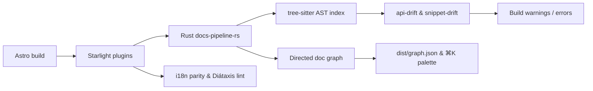

<div align="center">

  <p>
    <strong>A Starlight docs toolkit that verifies API references against source AST and keeps multilingual docs in parity.</strong><br/>
    Combines a Rust pipeline powered by tree-sitter with TypeScript plugins for OG images, glossaries, related pages, semantic doc graphs, and Diátaxis linting. Built for maintainers of Starlight sites who need fast, deterministic docs QA without hardcoded strings.
  </p>
  <p>
    <a href="https://www.npmjs.com/package/@elcoosp/docs-toolkit"></a>
    <a href="https://github.com/elcoosp/docs-toolkit/blob/main/LICENSE"></a>
    <a href="https://starlight.astro.build"></a>
    <a href="https://github.com/elcoosp/docs-toolkit/tree/main/crates/docs-pipeline-rs"></a>
  </p>
  <p>
    <a href="#quickstart">Quickstart</a> •
    <a href="#features">Features</a> •
    <a href="#how-it-works">How it works</a> •
    <a href="#usage">Usage</a> •
    <a href="#status">Status</a>
  </p>
</div>

## Quickstart

Requires Node.js 20+ and pnpm.

```bash
pnpm add @elcoosp/docs-toolkit
```

```js
// astro.config.mjs
import { defineDocsConfig } from '@elcoosp/docs-toolkit/config';

export default await defineDocsConfig({
  site: 'https://example.com',
  domain: 'example.com',
  title: 'My Docs',
  description: 'Documentation for my project',
  plugins: {
    smartTocProgress: true,
    termGlossary: true,
    i18nParity: true,
    relatedPages: true,
    diataxisLint: true,
    linkPreview: true,
    readingContext: true,
    apiDrift: { strict: false },
    snippetDrift: { strict: false },
    docGraph: { strict: false, warnOrphans: true },
  },
});
```

```bash
pnpm build
```

```text
Rust pipeline completed in 12 ms — doc-graph (42 nodes, 142 edges, 0 orphans) · api-drift (86% cov, 0 phantom) · snippet-drift (52 blocks, 0 issues)
```

## Features

- **AST-verified API & snippet drift**: `api-drift` and `snippet-drift` parse Rust and TypeScript with tree-sitter, flagging phantom symbols, syntax errors, and stale versions in `/reference/` pages and code blocks.
- **Semantic doc graph & PageRank**: `doc-graph` computes the directed link graph per locale, ranks hub pages with PageRank, detects orphan pages, writes `dist/graph.json`, and surfaces connected pages inside the `⌘K` palette.
- **Multilingual parity**: `i18n-parity` ensures every key in `i18n/en.json` has a matching entry in every locale, using the conventional Starlight translation flow.
- **Diátaxis-aware linting**: `diataxis-lint` checks that pages fit one of the four documentation types and warns when a tutorial becomes reference or vice versa.
- **Fast native pipeline**: the Rust `docs-pipeline-rs` crate runs AST extraction, link graph analysis, and API indexing in parallel with rayon, adding milliseconds to a build.
- **OG images and badges**: auto-derived accent colours, per-page PNG generation, and section badges from a single `defineDocsConfig` call.
- **Discovery plugins**: `⌘K` command palette, related pages, term glossary, smart TOC progress, link preview, and reading context.
- **No hardcoded strings**: every user-facing message flows through `injectTranslations` and the standard `i18n/*.json` files.

## How it works

`defineDocsConfig` wires Starlight plugins into the Astro build. When the native pipeline is enabled, the Rust binary builds a public-API index from your repository using tree-sitter, computes the directed documentation graph, and audits `/reference/` routes and code snippets in parallel.



The index covers `pub fn`, `pub struct`, `pub enum`, `pub trait`, enum variants, trait methods, macros, `pub use` re-exports, and TypeScript `export` declarations. The comparison respects page-level skip lists (`language`, `syntax`, `grammar`, `changelog`, etc.) and heading-level symbol extraction, so prose titles like “Construction” do not become phantom references.

## Usage

### Configuration

```js
// astro.config.mjs
import { defineDocsConfig } from '@elcoosp/docs-toolkit/config';

export default await defineDocsConfig({
  site: 'https://example.com',
  domain: 'example.com',
  title: 'My Docs',
  description: 'Documentation for my project',
  plugins: {
    apiDrift: { strict: true, writeReport: true },
    snippetDrift: { strict: true, writeReport: true },
    docGraph: { strict: false, warnOrphans: true },
    i18nParity: { defaultLocale: 'en' },
    diataxisLint: { warnOnly: false },
  },
});
```

### Individual plugins

```js
import {
  starlightSmartTocProgress,
  starlightTermGlossary,
  starlightI18nParity,
  starlightRelatedPages,
  starlightDiataxisLint,
} from '@elcoosp/docs-toolkit';

export default {
  plugins: [
    starlightSmartTocProgress(),
    starlightTermGlossary({
      entries: [{ term: 'AST', definition: 'Abstract syntax tree' }],
    }),
    starlightI18nParity(),
    starlightRelatedPages(),
    starlightDiataxisLint(),
  ],
};
```

### API drift & doc graph reports

```json
{
  "sourceSymbols": 1232,
  "matchedSymbols": 74,
  "coveragePct": 6,
  "phantoms": [],
  "warnings": [],
  "errors": []
}
```

Reports are written to `dist/api-drift.json`, `dist/snippet-drift.json`, and `dist/graph.json` during postbuild. Set `strict: true` to turn phantom references, snippet errors, or orphan pages into build errors.

## Status

> [!NOTE]
> Stable at v1.6.13. The Rust pipeline ships prebuilt binaries for macOS, Linux, and Windows through `assets/bin`; building from source requires a Rust toolchain. TypeScript plugins target Starlight on Astro 5+. The test suite covers unit, browser, and real-site e2e projects through Vitest.

## Learn more

- [Starlight plugin source](src/plugins)
- [Rust pipeline crate](crates/docs-pipeline-rs)
